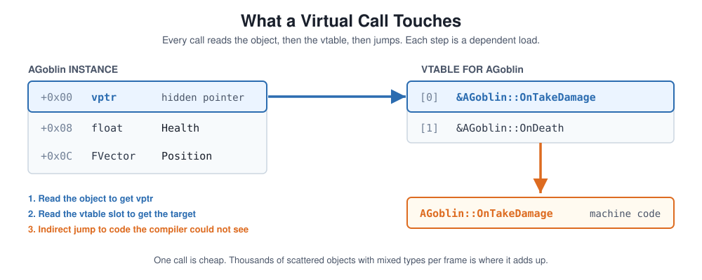

# The Cost of a Virtual Function

A projectile system ships with a clean hierarchy: `AProjectile`, `ABullet`, `AFireBullet`, each overriding a virtual `OnUpdate()`. It runs well in the first playtests with a few dozen projectiles in flight. Months later a new weapon type fires hundreds of pellets per shot, and the update loop starts showing up in captures. The profiler shows no single guilty function. It shows a loop that is slower than the sum of what its bodies do.

Nobody made a mistake here. The hierarchy was the right shape for the system the team believed it was building. What changed was the system's frequency, and nothing in the design said where the abstraction was supposed to stop.

---

## The Blind Spot: One Model for Every System

If you come from a managed-language background (C# or Java), polymorphism is the default tool. You create an abstract base class like `AEnemy`, mark a method `virtual`, override it in `AGoblin` and `AOrc`, and call it in a loop. That instinct is sound for most of a game's code, and there are two easy ways to get this topic wrong:

* **The Reactive Approach:** Use `virtual` everywhere and fix whatever the profiler flags. Usually fine, until a system that was never expected to be hot becomes hot, with a dozen features already built on its base class.
* **The Anti-Virtual Approach:** Treat `virtual` as a performance bug and strip it out on principle. That removes the seam designers and other programmers rely on, and buys nothing in the large part of the codebase that runs a few times per frame.

Neither survives contact with a real project. The mechanic sits underneath both. Runtime polymorphism is not the problem. **Applying the same abstraction model to a UI manager and to 100,000 hot-loop entities is.**

When a class has a virtual function, the compiler generates a **Virtual Method Table (Vtable)**, and every instance carries a hidden pointer (the `vptr`) to it.



Taken alone, one virtual call is cheap: a couple of dependent loads and an indirect jump. The cost appears when that call sits in a loop over many objects, and it has four separate sources:

1. **Scattered objects:** An array of base pointers usually points at heap objects allocated at different times. Reading each `vptr` means touching each object, so the loop pays for poor locality before any dispatch happens. This is the same memory-shape problem described in [Data Layout Is Architecture](DataLayoutIsArchitecture.md).
2. **Lost inlining:** The compiler cannot see through a call whose target is only known at runtime. A body that would collapse into a few instructions stays a real call, and every optimization that depends on seeing across that call (vectorization, hoisting, dead-code removal) is blocked.
3. **Unpredictable dispatch:** If `AGoblin` and `AOrc` are interleaved in the array, the indirect branch target changes from iteration to iteration. A branch predictor handles a stable pattern well and a shuffled one poorly. Different derived classes also live in different regions of code, which adds instruction cache pressure.
4. **The multiplier:** Each source is small per call. Multiplied by entity count and frame rate, it becomes the shape described in [Where Abstraction Meets The Hot Path](AbstractionMeetsTheHotPath.md): frequency times a boundary the compiler cannot see across.

> **The Unity / C# Perspective:** Managed environments make virtual methods, interfaces, and delegates feel like one abstract cost, and developers often build a habit of ignoring invocation overhead. In C++, where memory layout and dispatch model are explicit, that habit gets expensive in the narrow set of systems that run at high frequency. These costs are real in both worlds. C++ simply makes them visible and puts the decision in your hands.

---

## The Fix: Match Dispatch to Frequency

If you are writing high-level systems like UI managers, quest logic, or GameMode rules, a standard `virtual` function is the right choice. Instance counts are low, designers and other programmers benefit from the seam, and the overhead is not measurable against everything else in the frame.

For high-frequency, high-count systems (a projectile manager processing thousands of active bullets per frame, mass AI agents, particle behaviors, inventory modifiers evaluated across a whole collection), there are options that keep the variation without paying per-element dispatch.

### 1. Batch by Type

Often the cheapest change is not removing polymorphism but moving it up a level. Keep one flat array per projectile type and call the update once per array, not once per element. The virtual call, or a plain function call, now happens a handful of times per frame, and the inner loop is a tight pass over contiguous data.

### 2. Flat Data

Instead of a deep inheritance chain (`AProjectile` $\rightarrow$ `ABullet` $\rightarrow$ `AFireBullet`), express variation as data: a flat `USTRUCT` with parameters, and a specialized system that processes them in a predictable loop. Behavior differences become values and small branches, not separate classes with separate code paths.

### 3. CRTP and Templates

When the set of types is known at build time and you want polymorphic-looking code without runtime dispatch, the **Curiously Recurring Template Pattern (CRTP)** resolves calls at compile time (static binding), which lets the compiler inline them.

```cpp
// Base class template that uses compile-time static polymorphism
template <typename Derived>
class TProjectileBase
{
public:
    void Update(float DeltaTime)
    {
        // Static cast resolves the method at compile time: no Vtable lookup
        static_cast<Derived*>(this)->OnUpdate(DeltaTime);
    }
};

// Derived implementations
class FStandardBullet : public TProjectileBase<FStandardBullet>
{
public:
    void OnUpdate(float DeltaTime)
    {
        // Direct, inlinable machine instructions
    }
};
```

CRTP has a cost of its own. Different `Derived` types are unrelated types, so you cannot keep them in one heterogeneous array, which is why it pairs with option 1 (one container per type). It also lengthens build times, makes diagnostics harder, and locks the type set at compile time so designers cannot extend it without an engineer. Those trade-offs are covered in [Compile-Time Performance vs. Runtime Flexibility](CompileTimeVsRuntime.md). Reach for it when a hot path has stopped changing, not as a default.

### 4. Measure First

Do not rewrite a working hierarchy on principle. Profile the loop at realistic entity counts, and compare against a batched or flat version of the same logic. A conversion that is not justified by a measurement is the same mistake in the other direction: a boundary removed on instinct.

---

## The Insight: Dispatch Follows Frequency

The original hierarchy was reasonable when it was written. The part nobody owned was the point where the system crossed from "a few dozen objects, rarely" into "hundreds of objects, every frame." No single commit made the loop slow. A new weapon type changed the count, and the abstraction model stayed what it had always been.

This is the same placement question that [The `Tick()` Pitfalls](TickPitfalls.md) and [Garbage Collector Spikes](GarbageCollection.md) answer for scheduling and lifetime, and that [Where Abstraction Meets The Hot Path](AbstractionMeetsTheHotPath.md) answers for call chains: deciding, per system, whether code sits in the narrow, frequently executed fraction of the codebase or in the much larger fraction where clean abstraction should simply win. The same logic applies beyond a single process. [Network Tax](NetworkTax.md) extends it to backend calls, and [The Zero-Copy Trap](ZeroCopyTrap.md) shows an ownership model that looks clean on paper and fights the hardware underneath.

Virtual dispatch is just the most visible place to see it. The `virtual` keyword exposes an abstraction decision, and the profiler shows where that decision reached production frequency. The useful trigger is not a rule against virtual functions. **It is noticing when a system's instance count or update frequency changes**, at the point closest to when it shifts: in design review for the new weapon type, not in a scheduled audit or after QA files the bug.

---

## Production Bottom Line

> **Virtual Functions Were Never the Cost:** A virtual call in a UI manager, a quest system, or a GameMode rule is free in every way that matters, and it buys a seam other people can build on. What becomes expensive is the same abstraction model applied to thousands of scattered, mixed-type objects in a hot loop, where it blocks inlining, scatters memory access, and makes dispatch unpredictable.
>
> Banning `virtual` on principle removes flexibility the team still needs. Waiting for the profiler can miss a cost spread across a whole loop. The useful signal is the moment a system's count or frequency changes: treat that moment, not a keyword rule or a profiler alert, as the prompt to choose the dispatch model deliberately.
